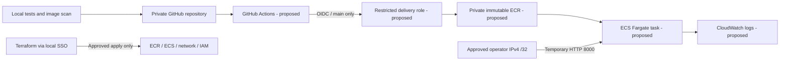

# Proposed ECS learning deployment - 2026-10-29

Status: proposed and locally validated; NOT DEPLOYED. No Terraform apply performed.

The tested app will be uploaded to private ECR, then ECS Fargate will run one copy.
CloudWatch receives logs. GitHub will use short-lived OIDC credentials rather than stored
AWS keys. Terraform describes infrastructure and supports reviewed teardown.

## Boundaries and decisions
- Stockholm eu-north-1 workload; us-east-1 only for existing Identity Center.
- Reuse default VPC and one public subnet after effective-route verification.
- No ALB, NAT gateway, database, custom domain, remote state service or multi-AZ availability.
- Assign one task public IP; allow TCP 8000 only from approved client /32.
  This is an ephemeral HTTP learning demo; no sensitive traffic or production availability.
- Outbound TCP 443 to internet needed for image layers and logs.
- Execution role: this ECR repository and app log streams; task role: no AWS API permissions.
- Optional GitHub trust restricted to main; scoped ECR/service/PassRole permissions.
  Registration API wildcard requirement is documented in infrastructure/terraform/README.md.
- One 0.25-vCPU/0.5-GiB task; up to two during a rolling deployment.
  ECS circuit breaker cannot roll back first deployment without a previous healthy revision.
- Read-only root, UID 10001 and dropped capabilities; app-owned temporary volume.
  Fargate-specific storage differs from local tmpfs. No claim of no-new-privileges on Fargate.
- One-day logs, no Container Insights. Alarm/incident work remains Stage 6.
- Local Terraform state kept out of Git; no secrets/plan dumps in shared evidence.
- CI owns later service task revisions; Terraform ignores that field to avoid reverting CI releases.

## Validation and approval boundaries
Terraform fmt/validate and read-only foundation/full plans completed; no apply.
Foundation plan has 9 resources; full illustrative plan 15. Full plan uses placeholder
digest/client address. Actual image upload, IAM/OIDC changes, public exposure and cleanup
each require concrete approval. Credit/expiry and budget delivery still unverified.
44 HIGH image findings remain with no listed fix; retain review before deployment.

## Sources
- https://docs.aws.amazon.com/AmazonECS/latest/developerguide/bind-mounts.html
- https://registry.terraform.io/providers/hashicorp/aws/latest/docs/resources/ecs_task_definition
- https://registry.terraform.io/providers/hashicorp/aws/latest/docs/resources/iam_openid_connect_provider
- https://docs.aws.amazon.com/AmazonECR/latest/userguide/image-scanning-basic.html
- https://aws.amazon.com/fargate/pricing/
- https://aws.amazon.com/vpc/pricing/
- https://aws.amazon.com/ecr/pricing/
